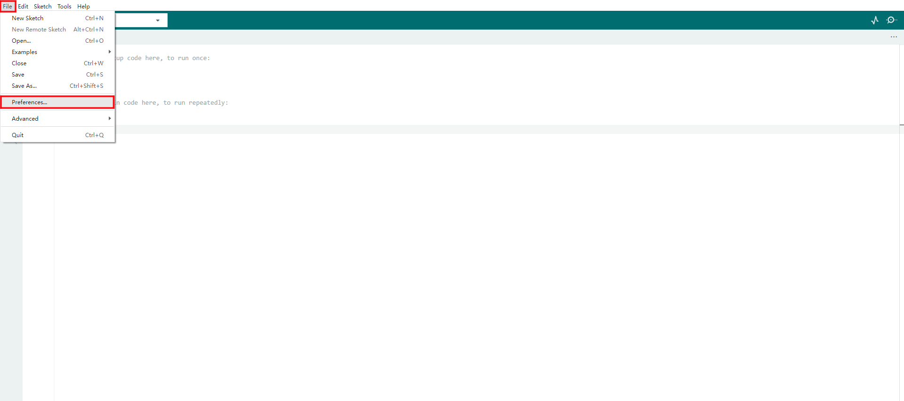
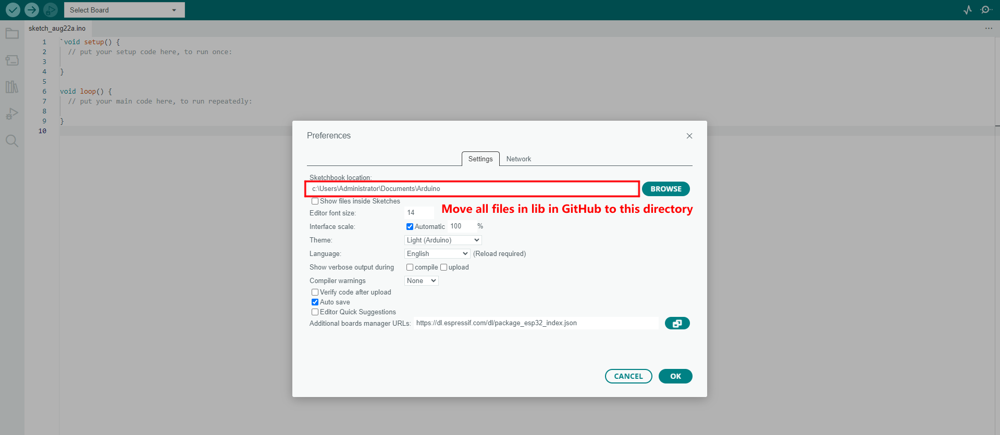
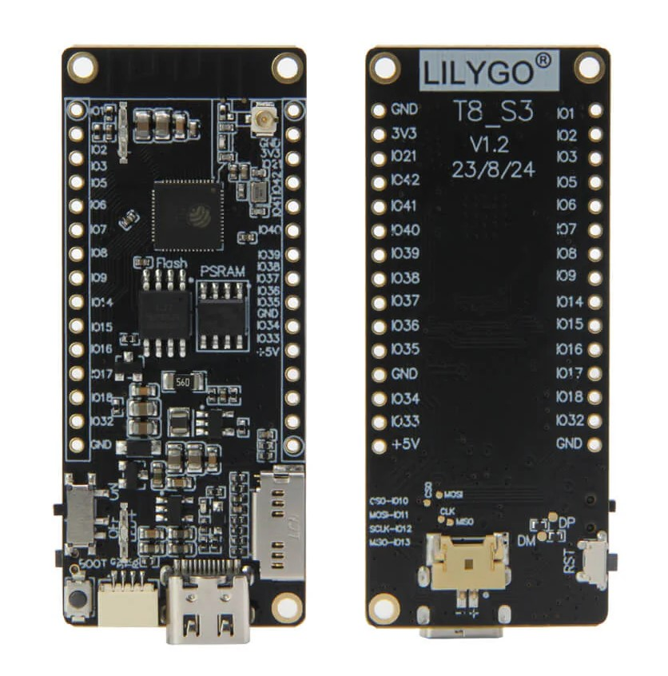

<!--
 * @Description: None
 * @Author: LILYGO_L
 * @Date: 2023-08-18 15:59:42
 * @LastEditTime: 2025-09-29 17:08:18
 * @License: GPL 3.0
-->
<h1 align = "center">🌟LILYGO T8 ESP32-S3🌟</h1>

## **[English](./README.md) | 中文**

<h3 align = "left">快速开始:</h3>

**使用PlatformIO**
1. 安装[VSCODE](https://code.visualstudio.com/)和[Python](https://www.python.org/)。
2. 在VSCODE扩展中搜索PlatformIO插件并安装。
3. 安装完成，重新加载后，左下角会多一个小房子图标，点击后即可显示Platformio IDE主页。
5. platformio.ini文件里取消注释“default_envs = xxx”可选择烧录的程序。
4. 点击文件->打开文件夹->选择T8-S3文件夹，点击左下角(√)符号进行编译， (→)进行烧录。

**使用ArduinoIDE**
1. 安装1.8以上的[Arduino IDE](http://www.arduino.cc/en/main/software)。
2. 打开Arduino IDE 在文件->首选项->附加开发板管理器网站添加 https://raw.githubusercontent.com/espressif/arduino-esp32/gh-pages/package_esp32_index.json .最后用以逗号隔开。(由于这个网站服务器在国外，可能比较慢或者不成功。也可以参考[LilyGo-Document](https://github.com/Xinyuan-LilyGO/LilyGo-Document)来搭建)。
3. 选择"工具"->开发板 -> dfrobot_firebeetle2_esp32s3。
4. Arduino用户需要将lib里的所有文件，连同文件夹一起移动到Arduino IDE里的库文件目录下，默认路径如图所示。

<h3 align = "left">Product 📷:</h3>

|  Product  | Product  Link  |
| :-------: | :------------: |
| [T8-S3]() | [AliExpress]() |

## Pinout

